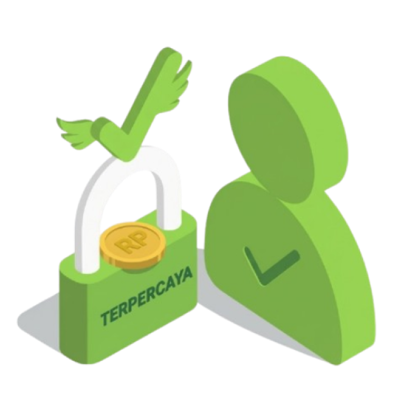
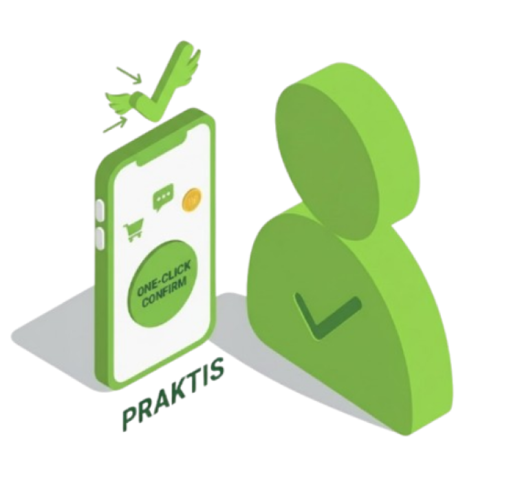

# 🚀 GasKampus (GasKam)

<p align="center">
  
  
  
  
  
</p>

<p align="center">
  <strong>Solusi mobilitas dan layanan mikro-kampus on-demand yang menghubungkan mahasiswa, driver mahasiswa, driver umum, dan pengelola kampus dalam satu ekosistem transportasi hemat, aman, dan terintegrasi.</strong>
</p>

---

## 📌 Daftar Isi
- [Tentang Proyek](#-tentang-proyek)
- [Tangkapan Layar & Demo](#-tangkapan-layar--demo)
- [Fitur Utama](#-fitur-utama)
- [Teknologi yang Digunakan (Tech Stack)](#-teknologi-yang-digunakan-tech-stack)
- [Prasyarat (Prerequisites)](#-prasyarat-prerequisites)
- [Panduan Instalasi & Menjalankan Proyek](#-panduan-instalasi--menjalankan-proyek)
- [Struktur Direktori](#-struktur-direktori)
- [Akun Demo & Panduan Penggunaan](#-akun-demo--panduan-penggunaan)
- [Kontribusi](#-kontribusi)
- [Lisensi](#-lisensi)

---

## 📖 Tentang Proyek

**GasKampus** adalah aplikasi multi-layanan kampus (*Campus Super-App*) berbasis Flutter yang dirancang khusus untuk memecahkan problematika mobilitas harian mahasiswa di lingkungan universitas. Tidak hanya menyediakan layanan antar-jemput ojek kampus bertarif terjangkau, GasKampus juga membuka peluang kerja paruh waktu bagi mahasiswa (*Student-Driver*) dengan penyesuaian jadwal kuliah yang fleksibel.

---

## 📱 Tangkapan Layar & Demo

| Onboarding 1 | Onboarding 2 | Onboarding 3 |
| :---: | :---: | :---: |
|  |  |  |
| *Solusi Mobilitas Kampus* | *Driver Mahasiswa Terpercaya* | *Tarif Ramah Kantong Mahasiswa* |

---

## ✨ Fitur Utama

### 👥 1. Sistem Multi-Role (4 Jenis Hak Akses)
- 🎓 **Mahasiswa (Customer):** Mengakses layanan pesan ojek, titip belanja, pesan makan, laundry, isi saldo dompet, dan tracking perjalanan secara *real-time*.
- 🛵 **Driver Mahasiswa:** Menerima orderan kampus, melihat navigasi rute, serta mengatur **jadwal kuliah vs jadwal narik** agar kuliah tetap prioritas.
- 🚗 **Driver Umum:** Melayani rute luar kampus dan pesanan reguler dengan navigasi terintegrasi.
- 🛡️ **Admin Kampus:** Dashboard pemantauan analitik aktivitas, monitoring pesanan, dan verifikasi akun driver.

### 🛵 2. Layanan Inti (*Core Services*)
- **Antar (Campus Ride):** Layanan antar-jemput motor cepat di sekitar fakultas, asrama, dan area kos-kosan.
- **Makan (Campus Food):** Pemesanan makanan dari kantin kampus dan warung makan sekitar tanpa potongan komisi tinggi.
- **Beliin (Campus Jastip):** Jasa titip pembelian perlengkapan kuliah, fotokopi, obat, atau barang darurat lainnya.
- **Laundry (Campus Wash):** Penjemputan dan pengantaran cucian pakaian dari kos ke mitra laundry kampus.

### 💳 3. Dompet Digital & Transaksi (GasPay)
- Informasi saldo instan **GasPay** dan **Koin Kampus**.
- Modal Top-Up dengan berbagai metode pembayaran (Virtual Account, E-Wallet, QRIS).
- Riwayat transaksi debit/kredit yang tercatat rapi.

### 💬 4. Komunikasi & Pelacakan Real-Time
- **Peta Driver Terdekat:** Radar lokasi driver aktif yang sedang beroperasi di sekitar kampus.
- **In-App Chat:** Fitur obrolan langsung antara pemesan dan driver untuk konfirmasi titik jemput.
- **Live Trip Status:** Status penjemputan, perjalanan aktif, hingga struk digital selesai trip.
- **Driver Favorit & Review:** Simpan driver favorit untuk pemesanan rutin serta berikan ulasan rating bintang.

### 🎨 5. Desain Modern & Mode Gelap
- Palet warna modern berkarakter *electric lime* (`#C0F637`).
- Dukungan **Dark Mode & Light Mode** otomatis sesuai preferensi sistem pengguna.

---

## 🛠 Teknologi yang Digunakan (Tech Stack)

| Komponen | Teknologi | Keterangan |
| :--- | :--- | :--- |
| **Framework** | [Flutter](https://flutter.dev/) (v3.27+) | UI Toolkit multi-platform dari Google |
| **Bahasa Pemrograman** | [Dart](https://dart.dev/) (^3.11.1) | Bahasa pemrograman berorientasi objek yang cepat & bertipe aman |
| **Typography** | [Google Fonts](https://pub.dev/packages/google_fonts) (Inter) | Tipografi bersih dan modern |
| **Desain UI** | Material Design 3 | Desain sistem kontemporer dengan dynamic color |
| **Ikon** | Material & Cupertino Icons | Ikonografi multi-platform Android dan iOS |
| **Target Platform** | Web (Chrome, Edge), Android, iOS, Windows | Arsitektur responsif untuk berbagai ukuran layar |

---

## 📋 Prasyarat (Prerequisites)

Sebelum menjalankan proyek ini di komputer lokal, pastikan perangkat lunak berikut telah terpasang:

1. **Git** (versi 2.x atau lebih baru) - [Download Git](https://git-scm.com/)
2. **Flutter SDK** (versi minimum 3.24.0 atau disarankan 3.27+) - [Instalasi Flutter](https://docs.flutter.dev/get-started/install)
3. **Dart SDK** (terbawa otomatis saat menginstal Flutter)
4. **Google Chrome** (untuk menjalankan versi Web)
5. **Android Studio** atau **VS Code** beserta ekstensi:
   - *Flutter* (ekstensi resmi)
   - *Dart* (ekstensi resmi)

Periksa kesehatan instalasi Flutter dengan menjalankan:
```bash
flutter doctor
```

---

## 🚀 Panduan Instalasi & Menjalankan Proyek

### 1. Masuk ke Direktori Proyek
```bash
cd gas_kampusapp
```

### 2. Pasang Dependensi
Unduh semua dependensi paket yang tertera di `pubspec.yaml`:
```bash
flutter pub get
```

### 3. Menjalankan Aplikasi

#### 🌐 Opsi A: Jalankan di Google Chrome (Web)
```bash
flutter run -d chrome
```
*Atau jalankan pada port spesifik:*
```bash
flutter run -d chrome --web-port=8080
```

#### 📱 Opsi B: Jalankan di Emulator Android / HP Fisik
Pastikan emulator atau perangkat USB debugging sudah terhubung, lalu jalankan:
```bash
flutter run
```

---

## 📂 Struktur Direktori

Berikut adalah gambaran hierarki direktori utama proyek:

```text
gas_kampusapp/
├── pubspec.yaml                 # Konfigurasi dependensi & aset
├── assets/
│   └── images/                  # Aset gambar onboarding & ilustrasi
│       ├── onboarding_1.png
│       ├── onboarding_2.png
│       └── onboarding_3.png
├── lib/
│   ├── main.dart                # Entry point aplikasi & konfigurasi tema
│   └── screens/
│       ├── onboarding_screen.dart    # Halaman perkenalan awal aplikasi
│       ├── login_screen.dart         # Halaman autentikasi multi-role
│       ├── register_screen.dart      # Registrasi pengguna baru
│       ├── wallet_screen.dart        # Detail dompet GasPay & riwayat
│       ├── notifications_screen.dart # Notifikasi & pengumuman
│       │
│       ├── main_pages/               # Layar antarmuka Mahasiswa (Customer)
│       │   ├── home_screen.dart          # Beranda utama (layanan, search, promo)
│       │   ├── pesanan_screen.dart       # Daftar & status pesanan aktif
│       │   ├── profile_screen.dart       # Profil akun mahasiswa
│       │   ├── promo_screen.dart         # Daftar voucher & promo
│       │   ├── chat_screen.dart          # Chat mahasiswa dengan driver
│       │   ├── favorite_drivers_screen.dart # Daftar driver langganan
│       │   └── topup_modal.dart          # Bottom sheet top-up saldo
│       │
│       ├── driver_pages/             # Layar antarmuka Driver Mahasiswa
│       │   ├── driver_home_screen.dart   # Dashboard status & toggle online/offline
│       │   ├── driver_jadwal_screen.dart # Pengaturan jadwal kuliah vs narik
│       │   ├── driver_profile_screen.dart# Profil & statistik rating driver
│       │   └── orders/                   # Siklus hidup pesanan driver
│       │       ├── driver_orders_screen.dart
│       │       ├── driver_navigation_screen.dart
│       │       ├── driver_active_trip_screen.dart
│       │       ├── driver_receipt_screen.dart
│       │       └── driver_trip_complete_screen.dart
│       │
│       ├── driver_umum_pages/        # Layar antarmuka Driver Umum
│       │   ├── driver_umum_home_screen.dart
│       │   ├── driver_umum_profile_screen.dart
│       │   └── orders/
│       │
│       ├── admin_pages/              # Layar antarmuka Admin Kampus
│       │   └── admin_home_screen.dart    # Monitoring performa & operasional
│       │
│       └── chat/
│           └── driver_chat_screen.dart
```

---

## 🔑 Akun Demo & Panduan Penggunaan

Aplikasi telah dilengkapi akun bawaan (*pre-configured demo accounts*) untuk mempermudah eksplorasi semua role:

| Role Pengguna | Username | Password | Akses Halaman |
| :--- | :--- | :--- | :--- |
| **Mahasiswa (Customer)** | `mahasiswa` | `mahasiswa` | `lib/screens/main_pages/home_screen.dart` |
| **Driver Mahasiswa** | `driverm` | `driverm` | `lib/screens/driver_pages/driver_home_screen.dart` |
| **Driver Umum** | `driveru` | `driveru` | `lib/screens/driver_umum_pages/driver_umum_home_screen.dart` |
| **Admin Kampus** | `admin` | `admin` | `lib/screens/admin_pages/admin_home_screen.dart` |

### Alur Operasional Singkat:
1. **Onboarding & Login:** Pengguna disambut oleh 3 slide onboarding interaktif dan masuk melalui halaman login dengan akun yang sesuai.
2. **Pemesanan Layanan (Mahasiswa):** Pilih menu (*Antar / Makan / Beliin / Laundry*), tentukan titik jemput dan tujuan, lalu lakukan konfirmasi pesanan.
3. **Penerimaan Order (Driver):** Driver menerima notifikasi permintaan perjalanan, membuka navigasi peta, dan mengubah status perjalanan hingga selesai.
4. **Pembayaran & Evaluasi:** Mahasiswa menyelesaikan pembayaran via GasPay dan memberikan rating bintang serta ulasan.

---

## 🤝 Kontribusi

Kontribusi dari seluruh pengembang sangat kami apresiasi! Jika Anda ingin berkontribusi:

1. **Fork** repositori ini.
2. Buat branch fitur baru:
   ```bash
   git checkout -b feature/FiturKerenBaru
   ```
3. Commit perubahan Anda:
   ```bash
   git commit -m "feat: Menambahkan fitur pelacakan rute baru"
   ```
4. Push ke branch Anda:
   ```bash
   git push origin feature/FiturKerenBaru
   ```
5. Buat **Pull Request (PR)** baru pada repositori utama.

---

## 📄 Lisensi

Proyek ini didistribusikan di bawah lisensi **MIT**. Silakan merujuk ke file `LICENSE` untuk informasi selengkapnya.

---

<p align="center">
  Dibuat dengan ❤️ untuk kemudahan mobilitas komunitas mahasiswa kampus.
</p>
