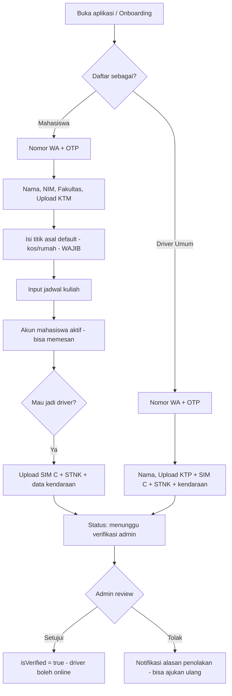
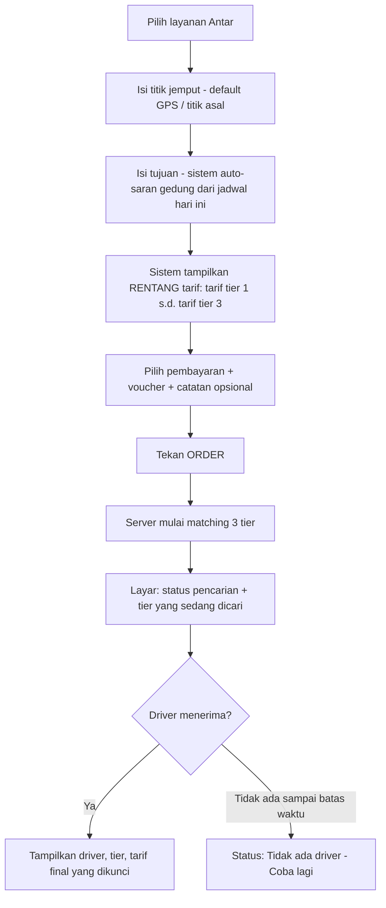
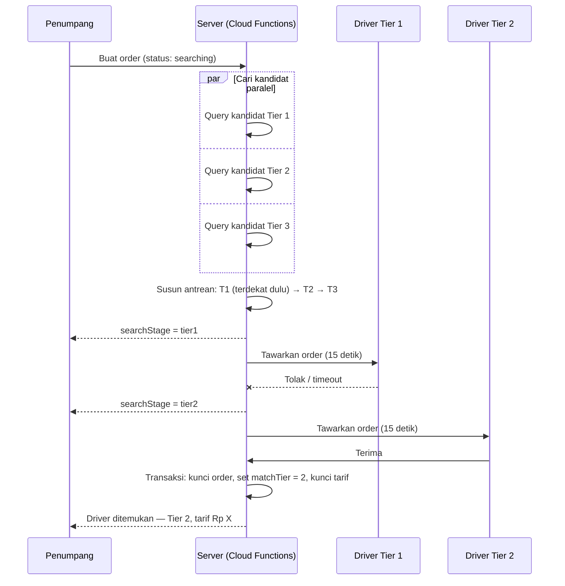
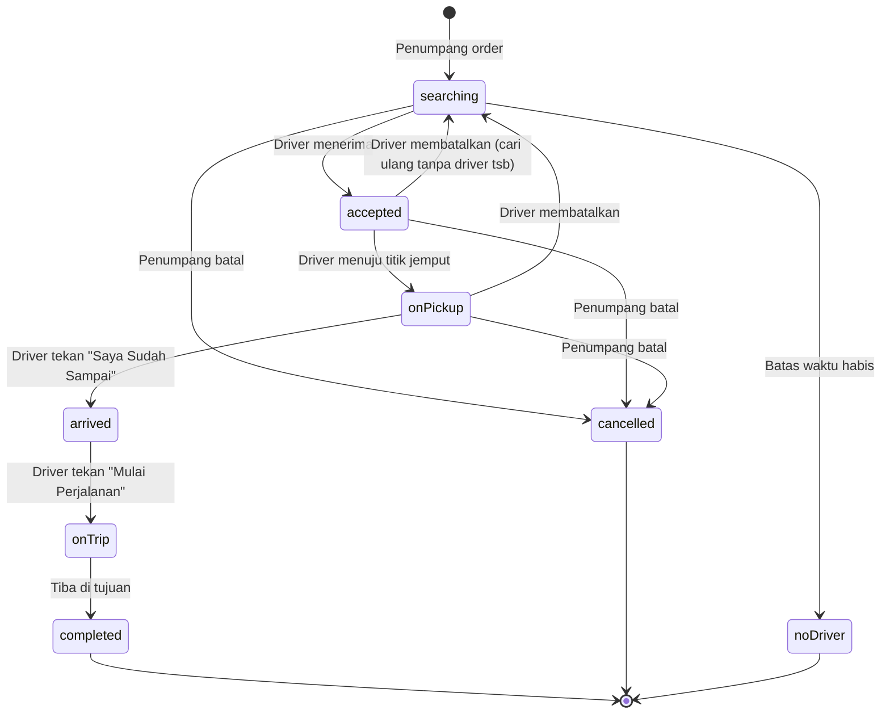
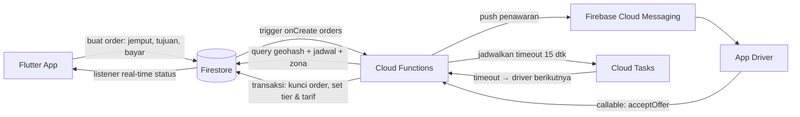

figma : https://www.figma.com/design/odbPrUoxjrig8qauAUHQTc/Project-Gas-Kampus?node-id=0-1&t=Xwcs1SiIAHW5Vfdy-1
# 🚀 GasKampus (GasKam)

<p align="center">
  
  
  
  
  
  
</p>

<p align="center">
  <strong>Solusi mobilitas kampus on-demand yang menghubungkan mahasiswa, driver mahasiswa, driver umum, dan pengelola kampus dalam satu ekosistem transportasi hemat, aman, dan terintegrasi — dengan sistem <em>One-Way Pick-Up</em> berbasis jadwal kuliah.</strong>
</p>

---

## 📌 Daftar Isi
- [Tentang Proyek](#-tentang-proyek)
- [Tangkapan Layar & Demo](#-tangkapan-layar--demo)
- [Fitur Utama](#-fitur-utama)
- [Proses Bisnis](#-proses-bisnis)
  - [Aktor & Hak Akses](#1-aktor--hak-akses)
  - [Registrasi & Verifikasi](#2-registrasi--verifikasi)
  - [Jadwal Kuliah, Titik Asal & Sistem Zona](#3-jadwal-kuliah-titik-asal--sistem-zona)
  - [Aktivasi Driver & Rekomendasi Jam Narik](#4-aktivasi-driver--rekomendasi-jam-narik)
  - [Alur Pemesanan (Penumpang)](#5-alur-pemesanan-penumpang)
  - [Sistem Matching 3 Tier (One-Way Pick-Up)](#6-sistem-matching-3-tier-one-way-pick-up)
  - [Penawaran Order & Pencarian Paralel](#7-penawaran-order--pencarian-paralel)
  - [Tarif](#8-tarif)
  - [Siklus Status Trip](#9-siklus-status-trip)
  - [Pembayaran & Bagi Hasil](#10-pembayaran--bagi-hasil)
  - [Pembatalan, Rating & Kasus Khusus](#11-pembatalan-rating--kasus-khusus)
  - [Admin Kampus](#12-admin-kampus)
- [Arsitektur Backend](#-arsitektur-backend)
- [Rancangan Model Data](#-rancangan-model-data)
- [Teknologi yang Digunakan (Tech Stack)](#-teknologi-yang-digunakan-tech-stack)
- [Prasyarat (Prerequisites)](#-prasyarat-prerequisites)
- [Panduan Instalasi & Menjalankan Proyek](#-panduan-instalasi--menjalankan-proyek)
- [Struktur Direktori](#-struktur-direktori)
- [Akun Demo & Panduan Penggunaan](#-akun-demo--panduan-penggunaan)
- [Status Pengembangan & Roadmap](#-status-pengembangan--roadmap)
- [Kontribusi](#-kontribusi)
- [Lisensi](#-lisensi)

---

## 📖 Tentang Proyek

**GasKampus** adalah aplikasi ojek kampus berbasis Flutter yang dirancang khusus untuk memecahkan problematika mobilitas harian mahasiswa di lingkungan universitas. Cara kerjanya mirip Gojek/Grab (cari driver terdekat, tracking, chat, bayar, rating), dengan satu pembeda utama: **One-Way Pick-Up**.

Mahasiswa memasukkan jadwal kuliah ke sistem. Ketika penumpang mahasiswa dan driver mahasiswa sama-sama punya kelas di **zona kampus yang sama** pada **jam yang berdekatan**, dan titik jemputnya **searah** dengan perjalanan driver, keduanya bisa **sekali jalan**. Driver memang sedang berangkat ke kampus, jadi tarifnya bisa jauh lebih murah untuk penumpang dan tetap jadi tambahan penghasilan untuk driver.

Kalau tidak ada yang searah, sistem otomatis mengeliminasi secara bertahap: driver mahasiswa yang sedang online biasa, lalu driver umum (non-mahasiswa).

**Prinsip utama:**
- 🎓 **Akun pelanggan wajib mahasiswa** — yang memesan hanya mahasiswa terverifikasi.
- 🛵 **Mahasiswa bisa jadi driver** — dan tetap bisa pindah ke *mode pelanggan* untuk memesan.
- 📚 **Kuliah tetap prioritas** — driver mahasiswa tidak akan ditawari order yang membuatnya telat masuk kelas.

---

## 📱 Tangkapan Layar & Demo

| Onboarding 1 | Onboarding 2 | Onboarding 3 |
| :---: | :---: | :---: |
|  |  |  |
| *Solusi Mobilitas Kampus* | *Driver Mahasiswa Terpercaya* | *Tarif Ramah Kantong Mahasiswa* |

Desain lengkap: [Figma – Project Gas Kampus](https://www.figma.com/design/odbPrUoxjrig8qauAUHQTc/Project-Gas-Kampus?node-id=0-1&t=Xwcs1SiIAHW5Vfdy-1)

---

## ✨ Fitur Utama

### 👥 1. Sistem Multi-Role (4 Jenis Hak Akses)
- 🎓 **Mahasiswa (Pelanggan):** Pesan ojek, input jadwal kuliah & titik asal, isi saldo dompet, tracking perjalanan secara *real-time*, chat, dan rating.
- 🛵 **Driver Mahasiswa:** Menerima orderan kampus, melihat navigasi rute, mendapat **rekomendasi jam narik** dari jadwal kuliah, dan bisa pindah ke **mode pelanggan** untuk memesan.
- 🚗 **Driver Umum:** Driver non-mahasiswa yang melayani pesanan reguler (prioritas terakhir dalam hierarki pencarian).
- 🛡️ **Admin Kampus:** Dashboard analitik, monitoring pesanan, verifikasi akun driver, pengelolaan zona & tarif.

### 🛵 2. Layanan Inti (*Core Services*)
- **Antar (Campus Ride) + One-Way Pick-Up:** Antar-jemput motor di sekitar fakultas, asrama, dan kos-kosan dengan pencocokan jadwal kuliah 3 tier.
- *(Fase 2 — ditunda)* **Makan (Campus Food)**, **Titip/Beliin (Campus Jastip)**, **Laundry**. Fokus MVP adalah Antar + One-Way karena itu pembeda utama GasKampus.

### 💳 3. Dompet Digital & Transaksi (GasPay)
- Informasi saldo instan **GasPay** dan **Koin Kampus**.
- Top-Up dengan berbagai metode pembayaran (Virtual Account, E-Wallet, QRIS).
- Riwayat transaksi debit/kredit (top-up, pembayaran, pendapatan driver, komisi, penarikan, refund).

### 💬 4. Komunikasi & Pelacakan Real-Time
- **Peta Driver Terdekat:** Radar lokasi driver aktif di sekitar kampus.
- **Status Tier Real-Time:** Penumpang melihat sistem sedang mencari di tier mana dan mendapat driver dari tier berapa.
- **In-App Chat:** Obrolan langsung antara pemesan dan driver untuk konfirmasi titik jemput.
- **Live Trip Status:** Status penjemputan, perjalanan aktif, hingga struk digital.
- **Driver Favorit & Review:** Simpan driver favorit serta beri rating bintang dua arah.

### 🎨 5. Desain Modern & Mode Gelap
- Palet warna modern berkarakter *electric lime* (`#C0F637`).
- Dukungan **Dark Mode & Light Mode** otomatis sesuai preferensi sistem pengguna.

---

## 🧭 Proses Bisnis

> Tanda **[asumsi]** = keputusan sementara yang belum dikonfirmasi pemilik proyek. Tanda **[menunggu keputusan]** = sudah dibahas, belum final.

### 1. Aktor & Hak Akses

| Aktor | Siapa | Bisa memesan? | Bisa narik? | Tier |
| :--- | :--- | :---: | :---: | :---: |
| **Mahasiswa** | Mahasiswa aktif terverifikasi | ✅ | ❌ | — |
| **Driver Mahasiswa** | Mahasiswa yang lolos verifikasi driver | ✅ (mode pelanggan) | ✅ | 1 atau 2 (ditentukan sistem) |
| **Driver Umum** | Non-mahasiswa yang lolos verifikasi driver | ❌ | ✅ | 3 |
| **Admin Kampus** | Pengelola | ❌ | ❌ | — |

- Driver mahasiswa punya **satu akun** dengan dua mode: **Mode Pelanggan** dan **Mode Driver**, yang bisa di-switch dari profil.
- **[asumsi]** Driver umum mendaftar lewat jalur pendaftaran driver terpisah dan tidak punya mode pelanggan, karena akun pelanggan wajib mahasiswa.

### 2. Registrasi & Verifikasi



- Driver yang belum diverifikasi **tidak bisa online**.
- **[menunggu keputusan]** Verifikasi email kampus (mis. `@mail.unpad.ac.id`) sebagai bukti mahasiswa aktif tanpa cek KTM manual. Ini cara paling murah, tapi masih menunggu keputusan pemilik proyek.

### 3. Jadwal Kuliah, Titik Asal & Sistem Zona

#### 3.1 Data yang wajib diisi semua mahasiswa (penumpang & driver)
| Data | Contoh | Dipakai untuk |
| :--- | :--- | :--- |
| Titik asal default (kos/rumah) | Kos Ciseke, koordinat GPS | Menentukan arah "searah", rekomendasi jam narik |
| Jadwal kuliah per hari | Senin 08:00–10:00, Fakultas X, Gedung A, R.302 | Menentukan zona tujuan & jam masuk/keluar |

#### 3.2 Sistem Zona Kampus
Kampus dibagi menjadi **4 zona: A, B, C, D**. Setiap zona berisi beberapa fakultas. Saat mahasiswa memasukkan jadwal, sistem membaca **fakultas → zona** secara otomatis.

| Zona | Fakultas |
| :---: | :--- |
| A | *(diisi admin)* |
| B | *(diisi admin)* |
| C | *(diisi admin)* |
| D | *(diisi admin)* |

> Pemetaan fakultas ke zona disimpan di Firestore (`zones`) dan bisa diubah admin, tidak di-hardcode di aplikasi.

**Patokan one-way bukan kelas yang sama**, melainkan **zona yang sama + jam yang berdekatan**. Analoginya: bukan "teman sekelas nebeng", tapi "orang yang memang lewat jalan yang sama ke area kampus yang sama".

#### 3.3 Jendela perjalanan
Dari jadwal, sistem membuat dua jenis jendela untuk tiap hari:
- **Berangkat:** sebelum jam mulai kelas pertama di suatu zona (mis. 08:00 → jendela 07:00–07:55).
- **Pulang:** setelah jam selesai kelas terakhir (mis. 10:00 → jendela 10:00–10:45). **[asumsi]** One-way berlaku untuk berangkat dan pulang.

### 4. Aktivasi Driver & Rekomendasi Jam Narik

- Driver hanya punya **dua status yang ia pilih sendiri: Online / Offline**.
- Driver **tidak memilih** "mode searah" atau "online biasa". **Sistem di belakang yang menentukan** apakah driver masuk tier 1 atau tier 2 untuk setiap order, berdasarkan jadwal, zona, waktu, dan posisinya.
- Selain itu ada penanda internal yang diatur sistem (bukan driver): `activeOrderId`. Kalau terisi, driver sedang membawa order dan tidak ditawari order lain.

**Rekomendasi jam narik** (dihitung dari jadwal driver):

| Jenis slot | Cara hitung | Pesan ke driver |
| :--- | :--- | :--- |
| 🟢 Slot Searah (tier 1) | Jendela berangkat & pulang driver | "Senin 07:15–07:50 — kamu searah ke Zona B. Online sekarang untuk tarif searah." |
| 🔵 Slot Kosong (tier 2) | Jeda antar kelas ≥ 90 menit, dikurangi buffer 15 menit sebelum kelas berikutnya | "Senin 10:15–12:45 — jam kosong, cocok untuk narik." |
| ⚪ Jangan narik | Saat jam kuliah berlangsung / < 15 menit sebelum kelas | Toggle online diberi peringatan |

- Rekomendasi ditampilkan di **Driver Home** dan **halaman Jadwal**, plus notifikasi push ±10 menit sebelum slot dimulai.
- *(Fase 2)* Rekomendasi juga mempertimbangkan data permintaan (jam ramai order) setelah data historis cukup.

### 5. Alur Pemesanan (Penumpang)



- Penumpang melihat **rentang tarif** sebelum order, sehingga tidak ada kejutan kalau ternyata dapat driver tier 2/3. Tarif final selalu ≤ batas atas rentang.

### 6. Sistem Matching 3 Tier (One-Way Pick-Up)

Server **mengeliminasi driver secara bertahap**, dari yang paling murah untuk penumpang sampai driver umum.

#### Syarat dasar semua tier
Driver `isOnline = true`, `isVerified = true`, `isActive = true`, `activeOrderId = null`, berada dalam radius jemput dari titik penumpang, dan bukan driver yang sudah menolak order ini.

#### Tier 1 — Driver Mahasiswa Searah (tarif jauh lebih murah)
Semua syarat berikut harus terpenuhi:
1. **Penumpang punya kelas** dalam jendela berangkat/pulang saat order dibuat, dan **tujuannya ada di zona kelas tersebut**.
2. **Driver mahasiswa juga punya kelas di zona yang sama** hari itu.
3. **Jam kelas berdekatan:** selisih jam mulai (berangkat) atau jam selesai (pulang) ≤ **30 menit** *(parameter, bisa diubah)*.
4. **Searah:** jemput penumpang tidak membuat driver memutar lebih dari **±1 km** *(parameter)*.
   ```
   detour = jarak(driver → jemput) + jarak(jemput → tujuan) − jarak(driver → tujuan)
   lolos jika detour ≤ 1 km
   ```
   Posisi driver = lokasi GPS saat online. Kalau tidak tersedia, pakai titik asal default.
5. Estimasi tiba di tujuan **tidak membuat driver telat** masuk kelasnya sendiri.

#### Tier 2 — Driver Mahasiswa Online Biasa (tarif sedikit lebih mahal)
- Driver mahasiswa online yang **tidak lolos tier 1** untuk order ini.
- **Tidak bentrok kelas:** `waktu sekarang + estimasi durasi trip + buffer 15 menit < jam mulai kelas berikutnya driver`.

#### Tier 3 — Driver Umum (tarif normal)
- Driver non-mahasiswa yang online dan memenuhi syarat dasar.

#### Urutan dalam satu tier
Berdasarkan **jarak/ETA ke titik jemput terdekat**. Jika sama, pakai rating lebih tinggi.

Kalau penumpang tidak punya kelas dalam jendela waktu (mis. order jam 10:17 ke kantin), **tier 1 otomatis dilewati** tanpa membuang waktu tunggu.

### 7. Penawaran Order & Pencarian Paralel

Pencarian kandidat di **ketiga tier dijalankan paralel** sejak order masuk. Penawaran ke driver tetap **satu per satu sesuai urutan tier**, supaya satu order tidak diterima dua driver sekaligus.



**Aturan penawaran:**
| Parameter | Default *(bisa diubah di `config/dispatch`)* |
| :--- | :--- |
| Waktu tunggu per driver | 15 detik |
| Maks. kandidat per tier | 3 driver |
| Batas total pencarian | 90 detik → status `noDriver` |
| Refresh kandidat | Setiap pindah tier (posisi driver berubah) |

**Yang dilihat penumpang secara real-time:**
- 🟢 "Mencari driver searah ke Zona B…" (tier 1)
- 🔵 "Mencari driver mahasiswa terdekat…" (tier 2)
- ⚪ "Mencari driver umum terdekat…" (tier 3)
- ✅ "Driver ditemukan — **Tier 1 · Searah**, tarif Rp X" (badge tier tampil di kartu driver & struk)

### 8. Tarif

Tarif dihitung **di server**, bukan di aplikasi.

```
tarifDasar = max(tarifMinimum, biayaBuka + tarifPerKm × jarakKm)
tarifTier  = tarifDasar × pengaliTier
tarifFinal = tarifTier − diskonPromo
```

| Tier | Pengali *(contoh, disimpan di `config/pricing`)* |
| :---: | :---: |
| 1 — Searah | 0,70 |
| 2 — Mahasiswa online | 0,85 |
| 3 — Driver umum | 1,00 |

- Tarif tier 1 tetap harus di atas biaya bensin + effort menjemput. Kalau terlalu murah, driver tidak tertarik, dan fitur searah jadi sepi.
- Tarif **dikunci saat driver menerima** dan tidak berubah sampai trip selesai.

### 9. Siklus Status Trip



Selama `accepted` sampai `onTrip` tersedia: chat, tracking lokasi live, tombol bagikan lokasi.

### 10. Pembayaran & Bagi Hasil

| Metode | Kapan dipotong | Pendapatan driver |
| :--- | :--- | :--- |
| GasPay (saldo) | Otomatis saat `completed` | Masuk wallet driver setelah dipotong komisi |
| QRIS | Saat `completed` | Sama seperti GasPay |
| Tunai | Dibayar langsung ke driver | Komisi platform dipotong dari saldo GasPay driver |

- **[asumsi]** Komisi platform berupa persentase dari tarif final (nilai di `config/pricing`).
- Setiap pergerakan uang dicatat sebagai `TransactionModel`: `topup`, `payment`, `earning`, `commission`, `withdrawal`, `refund`.

### 11. Pembatalan, Rating & Kasus Khusus

- **Penumpang batal** sebelum driver menerima → gratis. **[asumsi]** Aturan biaya batal setelah driver menerima ditentukan kemudian.
- **Driver batal** setelah menerima → order kembali `searching`, driver tersebut dikeluarkan dari antrean, dan pembatalan tercatat untuk evaluasi admin.
- **Rating dua arah** setelah `completed`: penumpang → driver, driver → penumpang (wajib sebelum driver bisa menerima order baru).
- **Driver offline/hilang sinyal saat trip** → order tetap aktif, penumpang diberi opsi hubungi driver atau laporkan ke admin.
- **Driver mahasiswa mendekati jam kelas** → sistem berhenti menawarinya order tier 2 dan memberi pengingat untuk offline.

### 12. Admin Kampus

- Verifikasi pendaftar driver (KTM/KTP, SIM, STNK): setujui atau tolak dengan alasan.
- Suspend/aktifkan driver (`isActive`).
- Monitoring order real-time & laporan (jumlah trip per tier, pendapatan, pembatalan).
- Kelola **pemetaan fakultas → zona**, parameter tarif (`config/pricing`), dan parameter dispatch (`config/dispatch`).
- Kelola promo/voucher.

---

## 🏗 Arsitektur Backend

### Kenapa matching & tarif harus di server
Kalau tier dan tarif dihitung di HP, pengguna bisa memanipulasi aplikasi untuk selalu dapat tarif tier 1. Selain itu, Firestore tidak bisa langsung menjawab "driver dalam radius 3 km". Karena itu:



| Masalah | Solusi |
| :--- | :--- |
| Cari driver terdekat | Simpan lokasi driver dalam bentuk **geohash** (package `geoflutterfire_plus` di app, `geofire-common` di Functions). Query per rentang geohash, lalu filter jarak sebenarnya (haversine). |
| Update lokasi driver | App driver menulis lokasi ke `driver_locations/{uid}` setiap ±10 detik / 50 m saat online (bukan ke dokumen user, supaya hemat write). |
| Matching & tier | Cloud Function `onOrderCreated` mengklasifikasi kandidat ketiga tier secara paralel (`Promise.all`) dan menyusun antrean di `orders/{id}/dispatch` (hanya bisa dibaca server). |
| Timeout per driver | **Cloud Tasks** menjadwalkan pengecekan 15 detik per penawaran. Kalau belum diterima, pindah ke kandidat berikutnya. |
| Dua driver menerima bersamaan | `acceptOffer` memakai **Firestore transaction**: hanya berhasil jika order masih `searching` dan penawaran ke driver itu masih berlaku. |
| Notifikasi order masuk | **FCM** (`firebase_messaging`). |
| Manipulasi data | **Security Rules:** aplikasi tidak boleh menulis `fareAmount`, `matchTier`, `driverId`, `status` (kecuali transisi milik driver yang sah lewat Functions), `isVerified`, saldo wallet. |
| Peta & navigasi | `google_maps_flutter` + `geolocator`; estimasi jarak/durasi via Directions API atau haversine untuk MVP. |

> ⚠️ Cloud Functions membutuhkan Firebase **Blaze plan** (bayar sesuai pemakaian, tetap ada kuota gratis). Untuk development, semua bisa dites gratis di **Firebase Local Emulator Suite**.

---

## 🗂 Rancangan Model Data

Model yang sudah ada di `lib/models/` dan perubahan yang dibutuhkan:

| Model | Firestore | Perubahan yang dibutuhkan |
| :--- | :--- | :--- |
| `UserModel` | `users/{uid}` | Ganti `role` menjadi `accountType: mahasiswa \| driver_umum \| admin`; tambah `isDriver`, `activeMode: pelanggan \| driver`, `facultyId`, `homeLocation` (lat, lng, alamat) **wajib untuk mahasiswa**. Perbaiki typo `facultas` → `faculty`. |
| `DriverProfileModel` | `users/{uid}/driver_profile` | Tambah `driverType: mahasiswa \| umum`. Status pilihan driver cukup `isOnline` (online/offline). Tambah `activeOrderId` (diatur server). Hapus `status` string. Tambah dokumen KTP untuk driver umum. |
| `DriverLocation` *(baru)* | `driver_locations/{uid}` | `lat`, `lng`, `geohash`, `updatedAt`, `isOnline`, `driverType` |
| `ScheduleModel` | `users/{uid}/schedules` | Berlaku untuk **semua mahasiswa** (bukan hanya driver). Tambah `facultyId`, `zoneId` (diisi otomatis dari fakultas). |
| `ZoneModel` *(baru)* | `zones/{zoneId}` | `name` (A/B/C/D), `facultyIds[]`, titik pusat zona |
| `OrderModel` | `orders/{id}` | Tambah `serviceType`, `matchTier` (1/2/3), `searchStage`, `destinationZoneId`, `fareBreakdown` (dasar, pengali, diskon, final), `fareRange` (min–max), `promoId`, `arrivedAt`, `startedAt`. Status: tambah `searching`, `arrived`, `noDriver` (ganti `pending`). Ganti `PaymentMethod.gopay` → `qris`. |
| `Dispatch` *(baru, server-only)* | `orders/{id}/dispatch/state` | `queue[]` (driverId, tier, jarak), `currentIndex`, `rejectedBy[]`, `deadline` |
| `WalletModel` / `TransactionModel` | `wallets/{uid}` | Tambah `TransactionType.commission` dan `refund` |
| `ReviewModel`, `PromoModel`, `ChatModel`, `NotificationModel`, `LeaderboardModel` | — | Sudah cukup untuk MVP |
| `config` *(baru)* | `config/pricing`, `config/dispatch` | Parameter tarif & dispatch yang bisa diubah admin |

---

## 🛠 Teknologi yang Digunakan (Tech Stack)

| Komponen | Teknologi | Keterangan |
| :--- | :--- | :--- |
| **Framework** | [Flutter](https://flutter.dev/) (v3.27+) | UI Toolkit multi-platform dari Google |
| **Bahasa Pemrograman** | [Dart](https://dart.dev/) (^3.11.1) | Bahasa pemrograman berorientasi objek yang cepat & bertipe aman |
| **Autentikasi** | Firebase Auth | Login OTP nomor WA / email |
| **Database** | Cloud Firestore | Data user, jadwal, order, wallet (real-time) |
| **Backend Logic** *(rencana)* | Cloud Functions + Cloud Tasks | Matching 3 tier, tarif, timeout penawaran |
| **Notifikasi** *(rencana)* | Firebase Cloud Messaging | Penawaran order & pengingat jam narik |
| **Peta & Lokasi** *(rencana)* | `google_maps_flutter`, `geolocator`, `geoflutterfire_plus` | Tracking & pencarian driver terdekat |
| **Typography** | [Google Fonts](https://pub.dev/packages/google_fonts) (Inter) | Tipografi bersih dan modern |
| **Desain UI** | Material Design 3 + [Figma](https://www.figma.com/design/odbPrUoxjrig8qauAUHQTc/Project-Gas-Kampus?node-id=0-1&t=Xwcs1SiIAHW5Vfdy-1) | Desain sistem kontemporer dengan dynamic color |
| **Ikon** | Material & Cupertino Icons | Ikonografi multi-platform Android dan iOS |
| **Target Platform** | Web (Chrome, Edge), Android, iOS, Windows | Arsitektur responsif untuk berbagai ukuran layar |

---

## 📋 Prasyarat (Prerequisites)

Sebelum menjalankan proyek ini di komputer lokal, pastikan perangkat lunak berikut telah terpasang:

1. **Git** (versi 2.x atau lebih baru) - [Download Git](https://git-scm.com/)
2. **Flutter SDK** (versi minimum 3.24.0 atau disarankan 3.27+) - [Instalasi Flutter](https://docs.flutter.dev/get-started/install)
3. **Dart SDK** (terbawa otomatis saat menginstal Flutter)
4. **Google Chrome** (untuk menjalankan versi Web)
5. **Android Studio** atau **VS Code** beserta ekstensi:
   - *Flutter* (ekstensi resmi)
   - *Dart* (ekstensi resmi)
6. *(Untuk backend)* **Node.js** LTS + **Firebase CLI** (`npm install -g firebase-tools`)

Periksa kesehatan instalasi Flutter dengan menjalankan:
```bash
flutter doctor
```

---

## 🚀 Panduan Instalasi & Menjalankan Proyek

### 1. Clone & Masuk ke Direktori Proyek
```bash
git clone https://github.com/sanjossye/gaskampusproject.git
cd gaskampusproject
```

### 2. Pasang Dependensi
Unduh semua dependensi paket yang tertera di `pubspec.yaml`:
```bash
flutter pub get
```

### 3. Menjalankan Aplikasi

#### 🌐 Opsi A: Jalankan di Google Chrome (Web)
```bash
flutter run -d chrome
```
*Atau jalankan pada port spesifik:*
```bash
flutter run -d chrome --web-port=8080
```
*(Windows: bisa juga lewat `run_web.bat`)*

#### 📱 Opsi B: Jalankan di Emulator Android / HP Fisik
Pastikan emulator atau perangkat USB debugging sudah terhubung, lalu jalankan:
```bash
flutter run
```
*(Windows: bisa juga lewat `run_emulator.bat`)*

---

## 📂 Struktur Direktori

Berikut adalah gambaran hierarki direktori utama proyek (kondisi saat ini):

```text
gaskampusproject/               # package: gas_kampusapp
├── pubspec.yaml                 # Konfigurasi dependensi & aset
├── firebase.json                # Konfigurasi project Firebase (gas-kampus)
├── assets/
│   └── images/                  # Aset gambar onboarding & ilustrasi
├── lib/
│   ├── main.dart                # Entry point aplikasi, init Firebase & tema
│   ├── firebase_options.dart    # Konfigurasi Firebase per platform
│   ├── models/                  # Model data (barrel: models.dart)
│   │   ├── user_model.dart          # UserModel + DriverProfileModel
│   │   ├── order_model.dart         # OrderModel, OrderStatus, PaymentMethod
│   │   ├── schedule_model.dart      # Jadwal kuliah
│   │   ├── wallet_model.dart        # Wallet + Transaction
│   │   ├── review_model.dart, promo_model.dart, chat_model.dart,
│   │   └── notification_model.dart, leaderboard_model.dart
│   ├── services/
│   │   └── admin_service.dart       # Query Firestore modul admin
│   └── screens/
│       ├── onboarding_screen.dart    # Halaman perkenalan awal aplikasi
│       ├── login_screen.dart         # Halaman autentikasi multi-role
│       ├── register_screen.dart      # Registrasi pengguna baru
│       ├── wallet_screen.dart        # Detail dompet GasPay & riwayat
│       ├── notifications_screen.dart # Notifikasi & pengumuman
│       │
│       ├── main_pages/               # Layar Mahasiswa (Pelanggan)
│       │   ├── home_screen.dart          # Beranda (layanan, search, promo)
│       │   ├── pesanan_screen.dart       # Cari driver, order aktif, riwayat
│       │   ├── nearby_drivers_modal.dart # Radar driver terdekat
│       │   ├── profile_screen.dart, settings_screen.dart
│       │   ├── promo_screen.dart, chat_screen.dart
│       │   ├── favorite_drivers_screen.dart
│       │   └── topup_modal.dart          # Bottom sheet top-up saldo
│       │
│       ├── driver_pages/             # Layar Driver Mahasiswa
│       │   ├── home/driver_home_screen.dart     # Dashboard & toggle online/offline
│       │   ├── jadwal/driver_jadwal_screen.dart # Jadwal kuliah vs narik
│       │   ├── profile/driver_profile_screen.dart
│       │   └── orders/                          # Siklus pesanan driver
│       │       ├── driver_orders_screen.dart
│       │       ├── driver_navigation_screen.dart
│       │       ├── driver_active_trip_screen.dart
│       │       ├── driver_trip_complete_screen.dart
│       │       └── driver_receipt_screen.dart
│       │
│       ├── driver_umum_pages/        # Layar Driver Umum (duplikat driver_pages — akan digabung)
│       │
│       ├── admin_pages/              # Layar Admin Kampus
│       │   ├── admin_home_screen.dart
│       │   ├── drivers/admin_drivers_screen.dart
│       │   ├── orders/admin_orders_screen.dart
│       │   ├── reports/admin_reports_screen.dart
│       │   └── verification/driver_verification_screen.dart
│       │
│       └── chat/
│           └── driver_chat_screen.dart
└── functions/                   # (rencana) Cloud Functions: matching, tarif, dispatch
```

---

## 🔑 Akun Demo & Panduan Penggunaan

Aplikasi saat ini memakai akun bawaan (*hardcoded demo accounts*) untuk eksplorasi semua role. Akan diganti Firebase Auth di Fase 1.

| Role Pengguna | Username | Password | Akses Halaman |
| :--- | :--- | :--- | :--- |
| **Mahasiswa (Pelanggan)** | `mahasiswa` | `mahasiswa` | `lib/screens/main_pages/home_screen.dart` |
| **Driver Mahasiswa** | `driverm` | `driverm` | `lib/screens/driver_pages/home/driver_home_screen.dart` |
| **Driver Umum** | `driveru` | `driveru` | `lib/screens/driver_umum_pages/driver_umum_home_screen.dart` |
| **Admin Kampus** | `admin` | `admin` | `lib/screens/admin_pages/admin_home_screen.dart` |

### Alur Operasional Singkat:
1. **Onboarding & Login:** 3 slide onboarding, lalu login/daftar sesuai role.
2. **Isi Profil Mahasiswa:** titik asal default + jadwal kuliah (sistem membaca fakultas → zona).
3. **Pemesanan (Mahasiswa):** pilih *Antar*, tentukan titik jemput & tujuan, lihat rentang tarif, lalu order.
4. **Matching 3 Tier (Server):** sistem mencari driver searah (tier 1) → driver mahasiswa online (tier 2) → driver umum (tier 3), dan penumpang melihat status tier secara real-time.
5. **Penerimaan Order (Driver):** driver menerima penawaran, navigasi ke titik jemput, "Saya Sudah Sampai", "Mulai Perjalanan", selesai.
6. **Pembayaran & Evaluasi:** pembayaran via GasPay/QRIS/tunai, lalu rating dua arah.

---

## 🗺 Status Pengembangan & Roadmap

### Status saat ini (Fase 0 — Prototipe UI)
- ✅ UI lengkap 4 role & alur trip driver.
- ✅ Model data dasar (`lib/models/`).
- ✅ Admin home & admin drivers sudah membaca Firestore (`AdminService`).
- ⚠️ Halaman lain masih data dummy; login masih hardcoded; register belum tersambung Firebase Auth.
- ❌ Belum ada: input jadwal penumpang, sistem zona, matching 3 tier, tarif per tier, rekomendasi jam narik, peta/geolokasi, FCM.

### Fase 1 — MVP
1. Firebase Auth (OTP) + registrasi mahasiswa (KTM, titik asal wajib) & driver.
2. Revisi model sesuai [Rancangan Model Data](#-rancangan-model-data).
3. Input jadwal kuliah untuk semua mahasiswa + pemetaan fakultas → zona.
4. Order *Antar* + Cloud Functions matching 3 tier paralel + status tier real-time.
5. Tarif per tier di server + rentang tarif sebelum order.
6. Peta, tracking lokasi live, geohash driver.
7. Rekomendasi jam narik di Driver Home & Jadwal.
8. GasPay, rating dua arah, verifikasi driver oleh admin terhubung Firestore.

### Fase 2 — Setelah MVP
- **Booking Searah** (pesan dari malam sebelumnya / pagi hari) supaya tier 1 lebih sering terjadi.
- Rekomendasi jam narik berbasis data permintaan.
- Verifikasi email kampus **[menunggu keputusan]**.
- Layanan Makan, Titip/Beliin, Laundry.

### Utang teknis
- [ ] **Hapus nama merek Gojek dari kode** (nama aplikasi tetap GasKampus, tapi di kode masih tersisa): teks "Gojek Kampus" di `login_screen`, `register_screen`, `pesanan_screen`, `chat_screen`, `driver_receipt_screen`; "Goride/Gocar" di `pesanan_screen` & `promo_screen`; "GoPay Campus/GoCoin/GoPay" di `home_screen`, `topup_modal`, `wallet_screen`, `pesanan_screen`; konstanta warna `GojekGreen/GojekNeon` di layar trip driver; `PaymentMethod.gopay` di `order_model.dart`. Ganti ke GasRide / GasPay / Koin Kampus.
- [ ] Gabungkan `driver_pages` dan `driver_umum_pages` menjadi satu modul dengan parameter `driverType`.
- [ ] Hapus `FirestoreTestPage` di `main.dart` setelah tes selesai.
- [ ] Ganti `withOpacity` (deprecated) → `withValues` (lihat `analyze.txt`).

---

## 🤝 Kontribusi

Kontribusi dari seluruh pengembang sangat kami apresiasi! Jika Anda ingin berkontribusi:

1. **Fork** repositori ini.
2. Buat branch fitur baru:
   ```bash
   git checkout -b feature/FiturKerenBaru
   ```
3. Commit perubahan Anda:
   ```bash
   git commit -m "feat: Menambahkan fitur pelacakan rute baru"
   ```
4. Push ke branch Anda:
   ```bash
   git push origin feature/FiturKerenBaru
   ```
5. Buat **Pull Request (PR)** baru pada repositori utama.

---

## 📄 Lisensi

Proyek ini didistribusikan di bawah lisensi **MIT**. Silakan merujuk ke file `LICENSE` untuk informasi selengkapnya.

---

<p align="center">
  Dibuat dengan ❤️ untuk kemudahan mobilitas komunitas mahasiswa kampus.
</p>