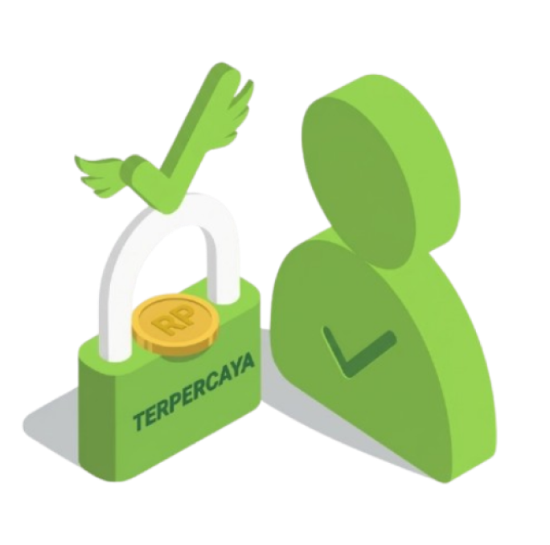
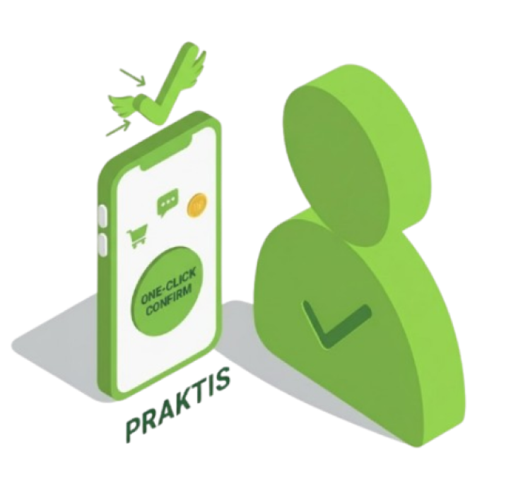
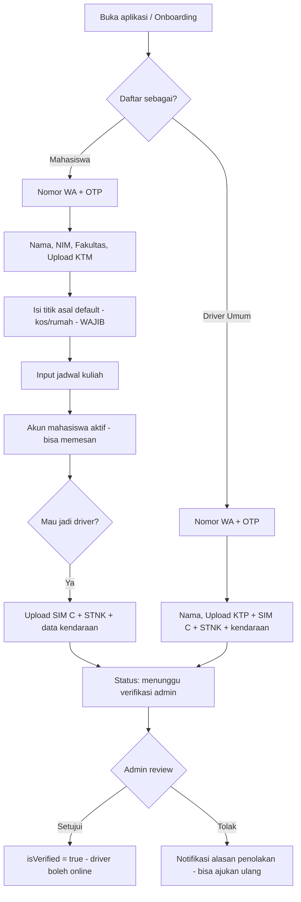
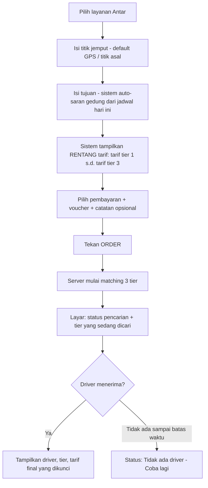
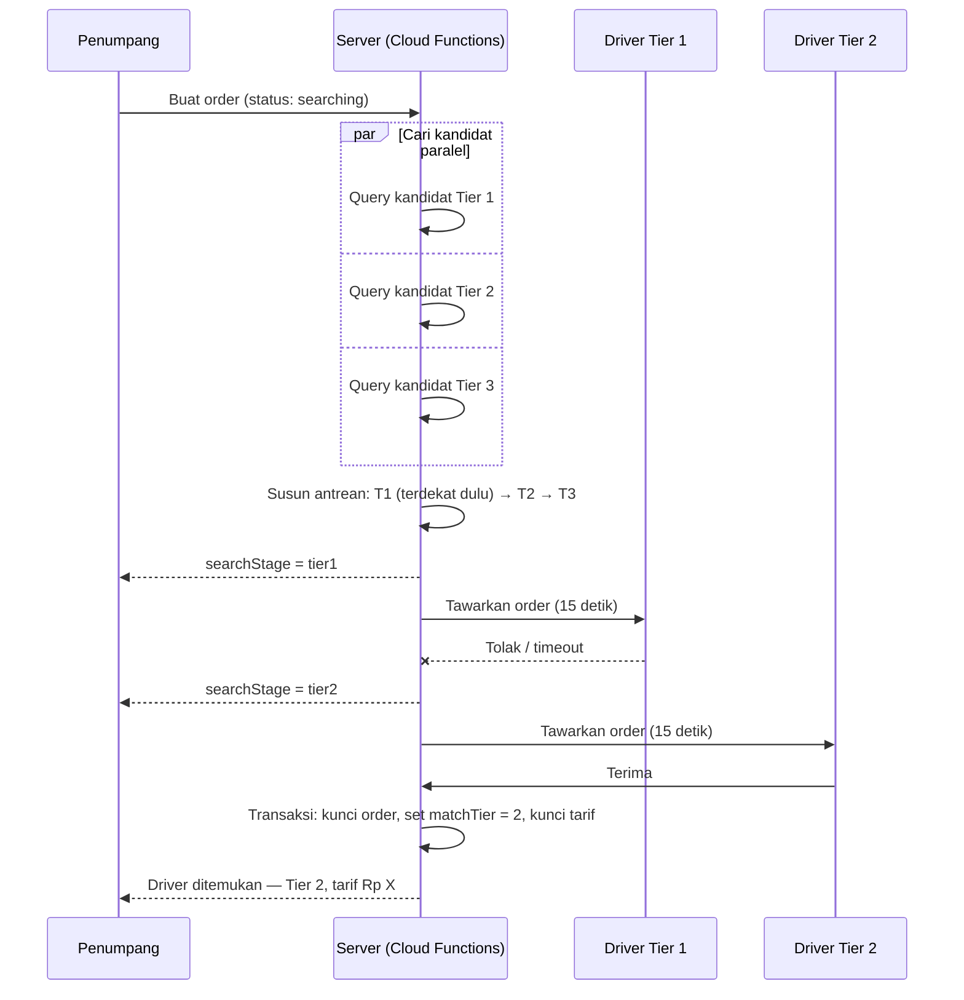
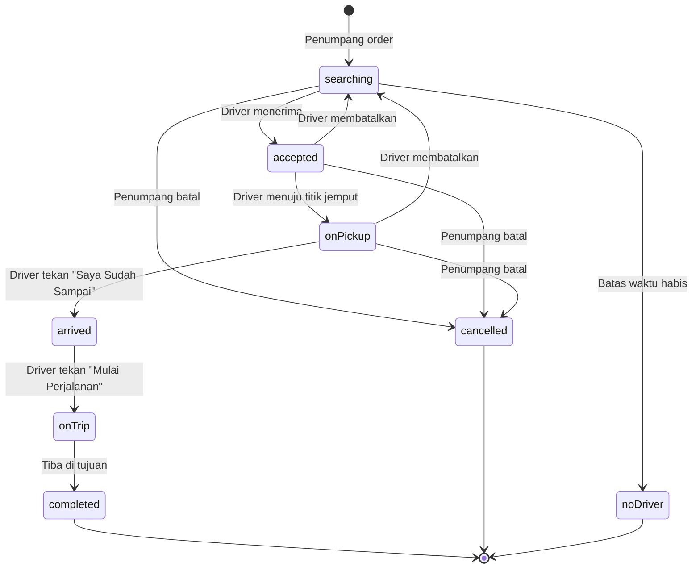
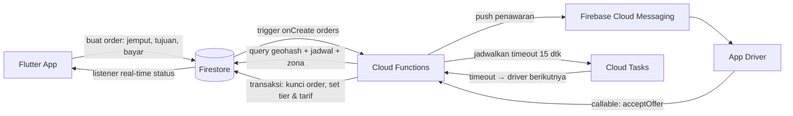

figma : https://www.figma.com/design/odbPrUoxjrig8qauAUHQTc/Project-Gas-Kampus?node-id=0-1&t=Xwcs1SiIAHW5Vfdy-1
# 🚀 GasKampus (GasKam)

<p align="center">
  
  
  
  
  
  
</p>

<p align="center">
  <strong>Solusi mobilitas kampus on-demand yang menghubungkan mahasiswa, driver mahasiswa, driver umum, dan pengelola kampus dalam satu ekosistem transportasi hemat, aman, dan terintegrasi — dengan sistem <em>One-Way Pick-Up</em> berbasis jadwal kuliah.</strong>
</p>

---

## 📌 Daftar Isi
- [Tentang Proyek](#-tentang-proyek)
- [Tangkapan Layar & Demo](#-tangkapan-layar--demo)
- [Fitur Utama](#-fitur-utama)
- [Proses Bisnis](#-proses-bisnis)
  - [Aktor & Hak Akses](#1-aktor--hak-akses)
  - [Registrasi & Verifikasi](#2-registrasi--verifikasi)
  - [Jadwal Kuliah, Titik Asal & Sistem Zona](#3-jadwal-kuliah-titik-asal--sistem-zona)
  - [Aktivasi Driver & Rekomendasi Jam Narik](#4-aktivasi-driver--rekomendasi-jam-narik)
  - [Alur Pemesanan (Penumpang)](#5-alur-pemesanan-penumpang)
  - [Sistem Matching 3 Tier (One-Way Pick-Up)](#6-sistem-matching-3-tier-one-way-pick-up)
  - [Penawaran Order & Pencarian Paralel](#7-penawaran-order--pencarian-paralel)
  - [Tarif](#8-tarif)
  - [Siklus Status Trip](#9-siklus-status-trip)
  - [Pembayaran & Bagi Hasil](#10-pembayaran--bagi-hasil)
  - [Pembatalan, Rating & Kasus Khusus](#11-pembatalan-rating--kasus-khusus)
  - [Admin Kampus](#12-admin-kampus)
- [Arsitektur Backend](#-arsitektur-backend)
- [Rancangan Model Data](#-rancangan-model-data)
- [Sistem Login & Autentikasi](#-sistem-login--autentikasi)
- [Teknologi yang Digunakan (Tech Stack)](#-teknologi-yang-digunakan-tech-stack)
- [Prasyarat (Prerequisites)](#-prasyarat-prerequisites)
- [Panduan Instalasi & Menjalankan Proyek](#-panduan-instalasi--menjalankan-proyek)
- [Struktur Direktori](#-struktur-direktori)
- [Akun Demo & Panduan Penggunaan](#-akun-demo--panduan-penggunaan)
- [Status Pengembangan & Roadmap](#-status-pengembangan--roadmap)
- [Kontribusi](#-kontribusi)
- [Lisensi](#-lisensi)

---

## 📖 Tentang Proyek

**GasKampus** adalah aplikasi ojek kampus berbasis Flutter yang dirancang khusus untuk memecahkan problematika mobilitas harian mahasiswa di lingkungan universitas. Cara kerjanya mirip Gojek/Grab (cari driver terdekat, tracking, chat, bayar, rating), dengan satu pembeda utama: **One-Way Pick-Up**.

Mahasiswa memasukkan jadwal kuliah ke sistem. Ketika penumpang mahasiswa dan driver mahasiswa sama-sama punya kelas di **zona kampus yang sama** pada **jam yang berdekatan**, dan titik jemputnya **searah** dengan perjalanan driver, keduanya bisa **sekali jalan**. Driver memang sedang berangkat ke kampus, jadi tarifnya bisa jauh lebih murah untuk penumpang dan tetap jadi tambahan penghasilan untuk driver.

Kalau tidak ada yang searah, sistem otomatis mengeliminasi secara bertahap: driver mahasiswa yang sedang online biasa, lalu driver umum (non-mahasiswa).

**Prinsip utama:**
- 🎓 **Akun pelanggan wajib mahasiswa** — yang memesan hanya mahasiswa terverifikasi.
- 🛵 **Mahasiswa bisa jadi driver** — dan tetap bisa pindah ke *mode pelanggan* untuk memesan.
- 📚 **Kuliah tetap prioritas** — driver mahasiswa tidak akan ditawari order yang membuatnya telat masuk kelas.

---

## 📱 Tangkapan Layar & Demo

| Onboarding 1 | Onboarding 2 | Onboarding 3 |
| :---: | :---: | :---: |
|  |  |  |
| *Solusi Mobilitas Kampus* | *Driver Mahasiswa Terpercaya* | *Tarif Ramah Kantong Mahasiswa* |

Desain lengkap: [Figma – Project Gas Kampus](https://www.figma.com/design/odbPrUoxjrig8qauAUHQTc/Project-Gas-Kampus?node-id=0-1&t=Xwcs1SiIAHW5Vfdy-1)

---

## ✨ Fitur Utama

### 👥 1. Sistem Multi-Role (4 Jenis Hak Akses)
- 🎓 **Mahasiswa (Pelanggan):** Pesan ojek, input jadwal kuliah & titik asal, isi saldo dompet, tracking perjalanan secara *real-time*, chat, dan rating.
- 🛵 **Driver Mahasiswa:** Menerima orderan kampus, melihat navigasi rute, mendapat **rekomendasi jam narik** dari jadwal kuliah, dan bisa pindah ke **mode pelanggan** untuk memesan.
- 🚗 **Driver Umum:** Driver non-mahasiswa yang melayani pesanan reguler (prioritas terakhir dalam hierarki pencarian).
- 🛡️ **Admin Kampus:** Dashboard analitik, monitoring pesanan, verifikasi akun driver, pengelolaan zona & tarif.

### 🛵 2. Layanan Inti (*Core Services*)
- **Antar (Campus Ride) + One-Way Pick-Up:** Antar-jemput motor di sekitar fakultas, asrama, dan kos-kosan dengan pencocokan jadwal kuliah 3 tier.
- *(Fase 2 — ditunda)* **Makan (Campus Food)**, **Titip/Beliin (Campus Jastip)**, **Laundry**. Fokus MVP adalah Antar + One-Way karena itu pembeda utama GasKampus.

### 💳 3. Dompet Digital & Transaksi (GasPay)
- Informasi saldo instan **GasPay** dan **Koin Kampus** — keduanya terhubung **real-time ke Firestore** (`wallets/{uid}`).
- Top-Up dengan berbagai metode pembayaran (Virtual Account, E-Wallet, QRIS).
- Riwayat transaksi debit/kredit (top-up, pembayaran, pendapatan driver, komisi, penarikan, refund).

### 💬 4. Komunikasi & Pelacakan Real-Time
- **Peta Driver Terdekat:** Radar lokasi driver aktif di sekitar kampus (hanya yang `isOnline: true`).
- **Status Tier Real-Time:** Penumpang melihat sistem sedang mencari di tier mana dan mendapat driver dari tier berapa.
- **In-App Chat:** Obrolan langsung antara pemesan dan driver untuk konfirmasi titik jemput.
- **Live Trip Status:** Status penjemputan, perjalanan aktif, hingga struk digital.
- **Driver Favorit & Review:** Simpan driver favorit serta beri rating bintang dua arah.

### 🎨 5. Desain Modern & Mode Gelap
- Palet warna modern berkarakter *electric lime* (`#C0F637`).
- Dukungan **Dark Mode & Light Mode** otomatis sesuai preferensi sistem pengguna.

---

## 🧭 Proses Bisnis

> Tanda **[asumsi]** = keputusan sementara yang belum dikonfirmasi pemilik proyek. Tanda **[menunggu keputusan]** = sudah dibahas, belum final.

### 1. Aktor & Hak Akses

| Aktor | Siapa | Bisa memesan? | Bisa narik? | Tier |
| :--- | :--- | :---: | :---: | :---: |
| **Mahasiswa** | Mahasiswa aktif terverifikasi | ✅ | ❌ | — |
| **Driver Mahasiswa** | Mahasiswa yang lolos verifikasi driver | ✅ (mode pelanggan) | ✅ | 1 atau 2 (ditentukan sistem) |
| **Driver Umum** | Non-mahasiswa yang lolos verifikasi driver | ❌ | ✅ | 3 |
| **Admin Kampus** | Pengelola | ❌ | ❌ | — |

- Driver mahasiswa punya **satu akun** dengan dua mode: **Mode Pelanggan** dan **Mode Driver**, yang bisa di-switch dari profil.
- **[asumsi]** Driver umum mendaftar lewat jalur pendaftaran driver terpisah dan tidak punya mode pelanggan, karena akun pelanggan wajib mahasiswa.

### 2. Registrasi & Verifikasi



- Driver yang belum diverifikasi **tidak bisa online**.
- **[menunggu keputusan]** Verifikasi email kampus (mis. `@mail.unpad.ac.id`) sebagai bukti mahasiswa aktif tanpa cek KTM manual.

### 3. Jadwal Kuliah, Titik Asal & Sistem Zona

#### 3.1 Data yang wajib diisi semua mahasiswa (penumpang & driver)
| Data | Contoh | Dipakai untuk |
| :--- | :--- | :--- |
| Titik asal default (kos/rumah) | Kos Ciseke, koordinat GPS | Menentukan arah "searah", rekomendasi jam narik |
| Jadwal kuliah per hari | Senin 08:00–10:00, Fakultas X, Gedung A, R.302 | Menentukan zona tujuan & jam masuk/keluar |

#### 3.2 Sistem Zona Kampus
Kampus dibagi menjadi **6 zona: A, B, C, D, E, F**. Setiap zona berisi beberapa fakultas/gedung. Saat mahasiswa memasukkan jadwal, sistem membaca **fakultas → zona** secara otomatis.

> Pemetaan fakultas ke zona disimpan di Firestore (`zones`) dan bisa diubah admin, tidak di-hardcode di aplikasi. Polygon zona bersumber dari `assets/zones/usu_zones.geojson` dan di-seed ke Firestore saat data demo diisi.

**Pemetaan Zona:**

| Zona | Tempat |
| :---: | :--- |
| **A** | Fak. Kedokteran (FK), Sekretariat BEM, Gelanggang Mahasiswa, Fasilkom-TI, Fak. Ilmu Budaya (FIB), Fak. Kedokteran Gigi (FKG), Gedung Pancasila, Fak. Kesehatan Masyarakat (FKM), Fak. Keperawatan (FKep) |
| **B** | Fak. Teknik (Arsitektur, Sipil, Kimia, Lingkungan), Aula Teknik, Perpustakaan USU, Fak. Psikologi, Magister Kenotariatan, Magister Manajemen |
| **C** | Politeknik Negeri Medan |
| **D** | Fak. Teknik (Elektro, Mesin, Industri), FMIPA, Fak. Farmasi (FF) |
| **E** | Fak. Vokasi, Fak. Pertanian (FP) |
| **F** | FISIP, Fak. Ekonomi dan Bisnis (FEB), Fak. Hukum (FH) |
1
> ⚠️ **Catatan:**
> - **Fakultas Teknik** **terbelah dua zona**: Zona B (Arsitektur, Sipil, Kimia, Lingkungan) dan Zona D (Elektro, Mesin, Industri). Penentu zona adalah **jurusan**, bukan nama fakultas. Field `jurusan` (nullable) tersedia di `UserModel` — wajib diisi jika fakultas = Teknik.
> - **Fakultas Kehutanan** sengaja **tidak memiliki zona** di kampus Padang Bulan (lokasi kampus terpisah jauh, `zoneOfUser` → `null`). Fakultas ini tetap tersedia di dropdown registrasi agar mahasiswanya tetap dapat memesan layanan.

**Patokan one-way bukan kelas yang sama**, melainkan **zona yang sama + jam yang berdekatan**.

#### 3.3 Jendela perjalanan
Dari jadwal, sistem membuat dua jenis jendela untuk tiap hari:
- **Berangkat:** sebelum jam mulai kelas pertama di suatu zona (mis. 08:00 → jendela 07:00–07:55).
- **Pulang:** setelah jam selesai kelas terakhir (mis. 10:00 → jendela 10:00–10:45).

### 4. Aktivasi Driver & Rekomendasi Jam Narik

- Driver hanya punya **dua status yang ia pilih sendiri: Online / Offline**.
- Driver **tidak memilih** "mode searah" atau "online biasa". **Sistem di belakang yang menentukan** apakah driver masuk tier 1 atau tier 2 untuk setiap order.

**Rekomendasi jam narik** (dihitung dari jadwal driver):

| Jenis slot | Cara hitung | Pesan ke driver |
| :--- | :--- | :--- |
| 🟢 Slot Searah (tier 1) | Jendela berangkat & pulang driver | "Senin 07:15–07:50 — kamu searah ke Zona B. Online sekarang untuk tarif searah." |
| 🔵 Slot Kosong (tier 2) | Jeda antar kelas ≥ 90 menit, dikurangi buffer 15 menit sebelum kelas berikutnya | "Senin 10:15–12:45 — jam kosong, cocok untuk narik." |
| ⚪ Jangan narik | Saat jam kuliah berlangsung / < 15 menit sebelum kelas | Toggle online diberi peringatan |

### 5. Alur Pemesanan (Penumpang)



### 6. Sistem Matching 3 Tier (One-Way Pick-Up)

#### Tier 1 — Driver Mahasiswa Searah (tarif jauh lebih murah)
1. Penumpang & driver punya kelas di **zona yang sama**, jam berdekatan (selisih ≤ 30 menit).
2. Jemput penumpang tidak membuat driver memutar lebih dari **±1 km** (parameter, bisa diubah).
3. Estimasi tiba di tujuan **tidak membuat driver telat** masuk kelas.

#### Tier 2 — Driver Mahasiswa Online Biasa (tarif sedikit lebih mahal)
- Driver mahasiswa online yang tidak lolos tier 1.
- Waktu sekarang + estimasi trip + buffer 15 menit < jam kelas berikutnya driver.

#### Tier 3 — Driver Umum (tarif normal)
- Driver non-mahasiswa yang online dan memenuhi syarat dasar.

### 7. Penawaran Order & Pencarian Paralel

Pencarian kandidat di **ketiga tier dijalankan paralel** sejak order masuk. Penawaran ke driver tetap **satu per satu sesuai urutan tier**.



| Parameter | Default *(bisa diubah di `config/dispatch`)* |
| :--- | :--- |
| Waktu tunggu per driver | 15 detik |
| Maks. kandidat per tier | 3 driver |
| Batas total pencarian | 90 detik → status `noDriver` |

### 8. Tarif

```
tarifDasar = max(tarifMinimum, biayaBuka + tarifPerKm × jarakKm)
tarifTier  = tarifDasar × pengaliTier
tarifFinal = tarifTier − diskonPromo
```

| Tier | Pengali *(disimpan di `distance_fare/pricing_rules`)* |
| :---: | :---: |
| 1 — Searah (khusus `GasRide`) | 0,70 |
| 2 — Mahasiswa online | 1,00 |
| 3 — Driver umum | 1,00 |

### 9. Siklus Status Trip



### 10. Pembayaran & Bagi Hasil

| Metode | Kapan dipotong | Pendapatan driver |
| :--- | :--- | :--- |
| GasPay (saldo) | Otomatis saat `completed` | Masuk wallet driver setelah dipotong komisi |
| QRIS | Saat `completed` | Sama seperti GasPay |
| Tunai | Dibayar langsung ke driver | Komisi platform dipotong dari saldo GasPay driver |

### 11. Pembatalan, Rating & Kasus Khusus

- **Penumpang batal** sebelum driver menerima → gratis.
- **Driver batal** setelah menerima → order kembali `searching`, driver dikeluarkan dari antrean.
- **Rating dua arah** setelah `completed`: wajib sebelum driver bisa menerima order baru.

### 12. Admin Kampus

- Verifikasi pendaftar driver (KTM/KTP, SIM, STNK): setujui atau tolak.
- Suspend/aktifkan driver (`isActive`).
- Monitoring order real-time & laporan.
- Kelola **pemetaan fakultas → zona**, parameter tarif (`distance_fare/pricing_rules`), dan parameter dispatch (`config/dispatch`).
- Kelola promo/voucher.

---

## 🏗 Arsitektur Backend



> ⚠️ Cloud Functions membutuhkan Firebase **Blaze plan**. Untuk development, semua bisa dites gratis di **Firebase Local Emulator Suite**.

---

## 🗂 Rancangan Model Data

| Model | Firestore | Keterangan |
| :--- | :--- | :--- |
| `UserModel` | `users/{uid}` | Field: `uid`, `name`, `email`, **`username`** (unik, lowercase), `nim`, `phone`, `role`, `facultas`, `isVerified`, `isActive`, **`isOnline`**, **`vehiclePlate`**, **`vehicleBrand`**, `rating`, `totalTrips`, `createdAt`, `updatedAt` |
| `DriverProfileModel` | `users/{uid}/driver_profile` | Field kendaraan driver: `vehicleType`, `vehiclePlate`, `vehicleBrand`, `isOnline`, `status`, `memberSince` |
| `WalletModel` | `wallets/{uid}` | Field: `userId`, **`balance`** (Rupiah), **`coins`** (Koin Kampus), `updatedAt` |
| `TransactionModel` | `wallets/{uid}/transactions/{id}` | Jenis: `topup`, `payment`, `earning`, `withdrawal`, `refund` |
| `ScheduleModel` | `users/{uid}/schedules` | Jadwal kuliah mahasiswa & driver |
| `OrderModel` | `orders/{id}` | Status: `searching`, `accepted`, `onPickup`, `arrived`, `onTrip`, `completed`, `cancelled`, `noDriver` |
| `ReviewModel` | — | Rating dua arah setelah trip selesai |
| `PromoModel` | — | Voucher & promo |
| `ChatModel` | — | Pesan in-app antara penumpang & driver |
| `NotificationModel` | — | Notifikasi push & in-app |
| `LeaderboardModel` | — | Papan peringkat driver |
| `login_index/{identifier}` | `login_index` | Indeks login: `{ email, uid, type: "nim"\|"username"\|"phone" }` |
| `distance_fare/pricing_rules`, `config/dispatch` | `distance_fare`, `config` | Parameter tarif (harga 1 km, 10 tier jarak, `tier1Multiplier`) & dispatch yang bisa diubah admin |

---

## 🔐 Sistem Login & Autentikasi

### Konsep
Sistem login **tidak mengharuskan user mengetik email**. Kolom input login menerima salah satu dari:
- **NIM** (khusus mahasiswa & driver kampus)
- **Username** (semua role)
- **Nomor HP** (semua role)

Firebase Auth tetap bekerja dengan Email & Password di balik layar, namun email tersebut dikelola otomatis oleh sistem.

### Komponen Utama

| File | Peran |
| :--- | :--- |
| [`lib/services/auth_services.dart`](lib/services/auth_services.dart) | `AuthService`: login, register, logout, normalizeIdentifier, readableError |
| [`lib/services/seed_services.dart`](lib/services/seed_services.dart) | `SeedService`: isi data demo ke Firebase Auth + Firestore |
| [`lib/services/wallet_service.dart`](lib/services/wallet_service.dart) | `WalletService`: top-up, debit, mutasi transaksi |
| [`lib/services/trip_service.dart`](lib/services/trip_service.dart) | `TripService`: alur perjalanan, bagi hasil, kalkulasi keuangan |
| [`lib/services/fare_pricing_service.dart`](lib/services/fare_pricing_service.dart) | `FarePricingService`: model tier tarif, baca config dari Firestore |
| [`lib/services/document_service.dart`](lib/services/document_service.dart) | `DocumentService`: simpan dokumen KTM/KTP/SIM/STNK driver |
| [`lib/services/map_route_service.dart`](lib/services/map_route_service.dart) | `MapRouteService`: rute peta, haversine distance, geolokasi |
| [`lib/services/admin_service.dart`](lib/services/admin_service.dart) | `AdminService`: query Firestore untuk dashboard admin |

### Koleksi `login_index`

Setiap user bisa punya hingga 3 dokumen di `login_index` (satu per identifier):

```
login_index/mahasiswa        → { email, uid, type: "username" }
login_index/140610240001     → { email, uid, type: "nim" }
login_index/6281200000001    → { email, uid, type: "phone" }
```

### Normalisasi Identifier (`AuthService.normalizeIdentifier`)

| Input user | Hasil normalisasi | Tipe terdeteksi |
| :--- | :--- | :--- |
| `"Mahasiswa"` | `"mahasiswa"` | username |
| `"140610240001"` | `"140610240001"` | nim |
| `"0812-0000-0001"` | `"6281200000001"` | phone |
| `"+6281200000001"` | `"6281200000001"` | phone |

### Alur Login

```
Input: "140610240001" + "gaskampus123"
  ↓ normalizeIdentifier → "140610240001"
  ↓ GET login_index/140610240001 → { email: "mahasiswa.demo@gaskampus-dev.com", uid }
  ↓ Firebase Auth: signInWithEmailAndPassword(email, password)
  ↓ GET users/{uid} → UserModel
  ↓ Cek isActive → route ke halaman sesuai role
```

### Keamanan

- Password **tidak pernah disimpan di Firestore** — hanya di Firebase Auth (hashed).
- Register menggunakan `WriteBatch`: dokumen `users/{uid}` dan semua `login_index` ditulis secara **atomic** (semuanya berhasil atau semua batal).
- Sebelum register, sistem mengecek keunikan NIM, username, dan nomor HP ke `login_index`.

### Firestore Security Rules (`firestore.rules`)

```javascript
// login_index: GET publik, LIST dilarang, write hanya untuk uid yang cocok
match /login_index/{id} {
  allow get: if true;
  allow list: if false;
  allow write: if request.auth != null && request.resource.data.uid == request.auth.uid;
}
// users/{uid}: read/write owner only; admin boleh read semua
match /users/{uid} {
  allow read: if request.auth.uid == uid || (admin check);
  allow write: if request.auth.uid == uid;
}
// Collection lain: hanya user yang login
match /{document=**} {
  allow read, write: if request.auth != null;
}
```

> ⚠️ Rules ini adalah **versi development** dan harus diperketat sebelum rilis production.

---

## 🛠 Teknologi yang Digunakan (Tech Stack)

| Komponen | Teknologi | Keterangan |
| :--- | :--- | :--- |
| **Framework** | [Flutter](https://flutter.dev/) (v3.27+) | UI Toolkit multi-platform dari Google |
| **Bahasa Pemrograman** | [Dart](https://dart.dev/) (^3.11.1) | Bahasa pemrograman berorientasi objek yang cepat & bertipe aman |
| **Autentikasi** | Firebase Auth (Email/Password) | Login dengan NIM / Username / Nomor HP via `login_index` |
| **Database** | Cloud Firestore | Data user, jadwal, order, wallet, login_index (real-time) |
| **Backend Logic** *(rencana)* | Cloud Functions + Cloud Tasks | Matching 3 tier, tarif, timeout penawaran |
| **Notifikasi** *(rencana)* | Firebase Cloud Messaging | Penawaran order & pengingat jam narik |
| **Peta & Lokasi** | `flutter_map` ^8.3.2, `geolocator` ^14.1.2, `latlong2` ^0.10.1 | Peta tile (Google Maps style), GPS perangkat, kalkulasi haversine |
| **HTTP Client** | `http` ^1.6.0 | Integrasi API rute jalan eksternal (OSRM / fallback) |
| **Storage & Media** | `firebase_storage` ^14.0.1, `image_picker` ^1.2.4 | Upload KTM/KTP/SIM/STNK driver |
| **URL & Deep Link** | `url_launcher` ^6.3.3 | Buka navigasi eksternal (Google Maps) |
| **Typography** | [Google Fonts](https://pub.dev/packages/google_fonts) (Inter) | Tipografi bersih dan modern |
| **Desain UI** | Material Design 3 + [Figma](https://www.figma.com/design/odbPrUoxjrig8qauAUHQTc/) | Desain sistem kontemporer dengan dynamic color |

---

## 📋 Prasyarat (Prerequisites)

Sebelum menjalankan proyek ini di komputer lokal, pastikan perangkat lunak berikut telah terpasang:

1. **Git** (versi 2.x atau lebih baru) — [Download Git](https://git-scm.com/)
2. **Flutter SDK** (versi minimum 3.24.0 atau disarankan 3.27+) — [Instalasi Flutter](https://docs.flutter.dev/get-started/install)
3. **Dart SDK** (terbawa otomatis saat menginstal Flutter)
4. **Google Chrome** (untuk menjalankan versi Web)
5. **Android Studio** atau **VS Code** beserta ekstensi Flutter & Dart
6. **JDK 17+** — pastikan `JAVA_HOME` mengarah ke direktori JDK yang valid
7. *(Untuk backend)* **Node.js** LTS + **Firebase CLI** (`npm install -g firebase-tools`)

Periksa kesehatan instalasi Flutter dengan menjalankan:
```bash
flutter doctor
```

> **Catatan JDK (Windows):** Jika muncul error `JAVA_HOME is set to an invalid directory`, pastikan `JAVA_HOME` di Environment Variables mengarah ke JDK yang benar (mis. `C:\Program Files\Eclipse Adoptium\jdk-21.0.12.101-hotspot`), lalu restart terminal/IDE.

---

## 🚀 Panduan Instalasi & Menjalankan Proyek

### 1. Clone & Masuk ke Direktori Proyek
```bash
git clone https://github.com/sanjossye/gaskampusproject.git
cd gaskampusproject
```

### 2. Pasang Dependensi
```bash
flutter pub get
```

### 3. Menjalankan Aplikasi

#### 🌐 Opsi A: Jalankan di Google Chrome (Web)
```bash
flutter run -d chrome
# atau pada port spesifik:
flutter run -d chrome --web-port=8080
```

#### 📱 Opsi B: Jalankan di Emulator Android / HP Fisik
```bash
flutter run
```

### 4. Isi Data Demo (Development)
Jalankan aplikasi dalam **debug mode**, lalu di halaman login tap tombol:
```
[DEV] Isi Data Dummy ke Firebase
```
Ini akan membuat semua akun demo di Firebase Auth & Firestore. Aman dijalankan berulang.

---

## 📂 Struktur Direktori

```text
gas_kampus/                       # package: gas_kampusapp
├── pubspec.yaml                   # Konfigurasi dependensi & aset
├── firebase.json                  # Konfigurasi project Firebase
├── firestore.rules                # Firestore Security Rules (dev)
├── assets/
│   └── images/                    # Aset gambar onboarding & ilustrasi
└── lib/
    ├── main.dart                  # Entry point aplikasi, init Firebase & tema
    ├── firebase_options.dart      # Konfigurasi Firebase per platform
    │
    ├── models/                    # Model data (barrel: models.dart)
    │   ├── user_model.dart            # UserModel + DriverProfileModel
    │   ├── order_model.dart           # OrderModel, OrderStatus, PaymentMethod
    │   ├── schedule_model.dart        # Jadwal kuliah
    │   ├── wallet_model.dart          # WalletModel (balance + coins) + TransactionModel
    │   ├── review_model.dart          # Rating dua arah
    │   ├── promo_model.dart           # Voucher & promo
    │   ├── chat_model.dart            # Pesan in-app
    │   ├── notification_model.dart    # Notifikasi
    │   ├── leaderboard_model.dart     # Papan peringkat driver
    │   └── models.dart               # Barrel export semua model
    │
    ├── services/
    │   ├── auth_services.dart         # AuthService: login (NIM/username/HP), register, logout, normalizeIdentifier
    │   ├── seed_services.dart         # SeedService: isi 8 akun demo ke Firebase (safe re-run)
    │   ├── admin_service.dart         # AdminService: query Firestore untuk dashboard admin
    │   ├── wallet_service.dart        # WalletService: top-up, debit, mutasi transaksi GasPay
    │   ├── trip_service.dart          # TripService: alur trip, bagi hasil, kalkulasi keuangan
    │   ├── fare_pricing_service.dart  # FarePricingService: tier tarif, baca config dari Firestore
    │   ├── document_service.dart      # DocumentService: simpan dokumen KTM/KTP/SIM/STNK
    │   └── map_route_service.dart     # MapRouteService: peta, haversine, geolokasi
    │
    └── screens/
        ├── onboarding_screen.dart     # 3 slide onboarding
        ├── login_screen.dart          # Login: NIM / Username / No. HP + password
        ├── register_screen.dart       # Registrasi pengguna baru
        ├── wallet_screen.dart         # Detail dompet GasPay & riwayat transaksi
        ├── notifications_screen.dart  # Notifikasi & pengumuman
        │
        ├── main_pages/                # Layar Mahasiswa (Pelanggan)
        │   ├── home_screen.dart           # Beranda: salam dinamis, saldo realtime, driver aktif
        │   ├── pesanan_screen.dart        # Cari driver, order aktif, riwayat
        │   ├── service_order_screen.dart  # Form pesanan layanan (Makan, Titip, Antar)
        │   ├── nearby_drivers_modal.dart  # Radar driver terdekat (hanya yang online)
        │   ├── jadwal_kuliah_screen.dart  # Input & kelola jadwal kuliah mahasiswa
        │   ├── profile_screen.dart        # Profil pengguna
        │   ├── settings_screen.dart       # Pengaturan akun & aplikasi
        │   ├── promo_screen.dart          # Voucher & promo aktif
        │   ├── chat_screen.dart           # In-app chat dengan driver
        │   ├── favorite_drivers_screen.dart # Daftar driver favorit
        │   └── topup_modal.dart           # Bottom sheet top-up saldo GasPay
        │
        ├── driver_pages/              # Layar Driver Mahasiswa
        │   ├── home/driver_home_screen.dart        # Dashboard & toggle online/offline
        │   ├── jadwal/driver_jadwal_screen.dart    # Jadwal kuliah vs rekomendasi jam narik
        │   ├── profile/driver_profile_screen.dart  # Profil & data kendaraan
        │   └── orders/
        │       ├── driver_orders_screen.dart        # Daftar & riwayat order
        │       ├── driver_navigation_screen.dart    # Navigasi menuju titik jemput
        │       ├── driver_active_trip_screen.dart   # Perjalanan aktif
        │       ├── driver_trip_complete_screen.dart # Konfirmasi trip selesai
        │       └── driver_receipt_screen.dart       # Struk digital
        │
        ├── driver_umum_pages/         # Layar Driver Umum (akan digabung dengan driver_pages)
        │   ├── driver_umum_home_screen.dart
        │   ├── driver_umum_profile_screen.dart
        │   ├── jadwal/driver_umum_jadwal_screen.dart
        │   └── orders/
        │       ├── driver_umum_orders_screen.dart
        │       ├── driver_umum_navigation_screen.dart
        │       ├── driver_umum_active_trip_screen.dart
        │       ├── driver_umum_trip_complete_screen.dart
        │       └── driver_umum_receipt_screen.dart
        │
        ├── admin_pages/               # Layar Admin Kampus
        │   ├── admin_home_screen.dart
        │   ├── drivers/admin_drivers_screen.dart
        │   ├── orders/admin_orders_screen.dart
        │   ├── reports/admin_reports_screen.dart
        │   ├── settings/admin_fare_settings_modal.dart  # Pengaturan tarif per tier
        │   └── verification/driver_verification_screen.dart
        │
        └── chat/
            └── driver_chat_screen.dart
```

---

## 🔑 Akun Demo & Panduan Penggunaan

Jalankan fungsi **Seed Data** dari halaman login (tombol `[DEV] Isi Data Dummy ke Firebase`) untuk mengisi semua akun di bawah ini.

### Akun Demo (password semua: `gaskampus123`)

> Login bisa menggunakan **Username**, **NIM**, atau **Nomor HP**.

#### 🎓 Mahasiswa (Pelanggan)

| Username | NIM | Nomor HP | Nama | Saldo | GoCoin |
| :--- | :--- | :--- | :--- | :--- | :--- |
| `mahasiswa` | `140610240001` | `081200000001` | Ahmad Zaki (FISIP) | Rp 75.000 | 3.500 |
| `mahasiswa2` | `140610240010` | `081200000010` | Siti Nurhaliza (Teknik) | Rp 125.000 | 8.200 |
| `mahasiswa3` | `140610240011` | `081200000011` | Rafi Alamsyah (FMIPA) | Rp 32.000 | 1.250 |

#### 🛵 Driver Mahasiswa

| Username | NIM | Nomor HP | Nama | Status | Saldo | GoCoin |
| :--- | :--- | :--- | :--- | :--- | :--- | :--- |
| `driverm` | `140810230002` | `081200000002` | Budi Santoso (FMIPA) | 🟢 Online | Rp 210.000 | 500 |
| `driverm2` | `140810230012` | `081200000012` | Siti Aminah (FEB) | 🟢 Online | Rp 165.000 | 750 |

#### 🚗 Driver Umum

| Username | Nomor HP | Nama | Status | Saldo | GoCoin |
| :--- | :--- | :--- | :--- | :--- | :--- |
| `driveru` | `081200000003` | Agus Prabowo | 🟢 Online | Rp 340.000 | 300 |
| `driveru2` | `081200000013` | Rizky Pratama | ⚫ Offline | Rp 85.000 | 100 |

#### 🛡️ Admin

| Username | Nama |
| :--- | :--- |
| `admin` | Admin Kampus |

### Alur Operasional Singkat:
1. **Seed data** → tap `[DEV] Isi Data Dummy ke Firebase` di halaman login.
2. **Login** menggunakan username, NIM, atau nomor HP + password `gaskampus123`.
3. **Beranda mahasiswa** menampilkan salam dinamis sesuai waktu, saldo & GoCoin real-time, dan daftar driver yang sedang online.
4. **Radar driver** (tap kartu "Lihat Driver Terdekat") menampilkan hanya driver online diurutkan dari terdekat.

---

## 🗺 Status Pengembangan & Roadmap

### Status saat ini (Fase 0 — Prototipe UI + Autentikasi Firebase)

| Fitur | Status |
| :--- | :--- |
| UI lengkap 4 role & alur trip driver | ✅ |
| Model data dasar (`lib/models/`) | ✅ |
| Firebase Auth + sistem login NIM/Username/HP | ✅ |
| Koleksi `login_index` di Firestore | ✅ |
| Data seed 8 akun demo (safe re-run) | ✅ |
| Saldo & GoCoin real-time dari Firestore (`wallets/{uid}`) | ✅ |
| Nama user real-time dari Firestore (`users/{uid}`) | ✅ |
| Salam beranda dinamis (Pagi/Siang/Sore/Malam) | ✅ |
| Driver aktif hanya tampil jika `isOnline: true` | ✅ |
| Service layer: `WalletService`, `TripService`, `FarePricingService`, `DocumentService`, `MapRouteService` | ✅ |
| Firestore Security Rules (versi dev) | ✅ |
| Input jadwal penumpang ke Firestore | ⚠️ UI ada, belum tersambung |
| 6 zona A–F dari GeoJSON asset, seed ke Firestore (`ZoneService`) | ✅ |
| `zoneOfPoint`, `zoneOfSchedule`, `evaluateTier` (pure functions, unit tested) | ✅ |
| Wiring `evaluateTier` ke alur terima order (`trip_service.dart`) | ❌ TODO |
| Cloud Functions matching 3 tier paralel (dispatch, tarif, timeout) | ❌ |
| Cloud Functions (dispatch, tarif, timeout) | ❌ |
| Peta tile (Google Maps style) di Beranda & Radar driver | ✅ |
| GPS perangkat di Beranda (posisi mahasiswa realtime) | ✅ |
| Lokasi driver di Radar: data statis (jarak estimasi haversine) | ✅ |
| Tracking GPS driver live ke Firestore | ❌ |
| FCM (notifikasi penawaran order) | ❌ |

### Fase 1 — MVP
1. Firebase Auth OTP + registrasi mahasiswa (KTM, titik asal wajib) & driver.
2. Input jadwal kuliah untuk semua mahasiswa + pemetaan fakultas → zona.
3. Order *Antar* + Cloud Functions matching 3 tier paralel + status tier real-time.
4. Tarif per tier di server + rentang tarif sebelum order.
5. Peta, tracking lokasi live, geohash driver.
6. Rekomendasi jam narik di Driver Home & Jadwal.
7. Rating dua arah, verifikasi driver oleh admin terhubung Firestore.

### Fase 2 — Setelah MVP
- **Booking Searah** (pesan dari malam sebelumnya / pagi hari).
- Rekomendasi jam narik berbasis data permintaan historis.
- Verifikasi email kampus **[menunggu keputusan]**.
- Layanan Makan, Titip/Beliin, Laundry.

### Utang Teknis
- [ ] **Logika zona & tarif tier berjalan di client** — `evaluateTier`, `zoneOfPoint`, `applyTierMultiplier` saat ini di Flutter client, belum dipindah ke Cloud Functions. Rawan manipulasi sebelum production.
- [ ] **Wiring `evaluateTier` ke alur terima order** — field `matchTier` & `fareFinal` sudah ada di `OrderModel`, tapi pengisian saat driver menerima order di `trip_service.dart` belum dikerjakan.
- [ ] **Tier 1 hanya berlaku untuk `GasRide` (motor)** — pesanan `GasCar` (mobil) tidak mendapatkan promo Tier 1 searah.
- [ ] **Backup tarif di `announcements/fare_pricing_config` sebaiknya dipindah** dari koleksi `announcements` ke koleksi konfigurasi khusus agar tidak bercampur dengan data pengumuman.
- [ ] **Tier 1 hanya untuk jendela BERANGKAT** — saat ini `evaluateTier` hanya mengecek kelas di depan ≤ 30 menit (tujuan di dalam zona kampus). Jendela PULANG belum didukung karena titik tujuan (kos/rumah) berada di luar zona kampus.
- [ ] **Zona driver diambil dari profil (`facultas`/`jurusan`)** — ditentukan lewat `zoneOfUser(driver.facultas, driver.jurusan)`. Jika driver mengambil kelas lintas fakultas di luar zona profilnya sendiri, belum terdeteksi.
- [ ] **`register_screen.dart` menyimpan label dropdown fakultas** — saat ini sudah didukung penuh oleh `_facultyAliases` + dropdown jurusan wajib jika Fakultas Teknik, namun ke depan sebaiknya dropdown langsung menyimpan kode tetap (`FK`, `FT`, `FMIPA`, `SIPIL`, `ELEKTRO`, dst.).
- [ ] **Hapus nama merek Gojek dari kode** — ganti ke GasRide / GasPay / Koin Kampus (tersisa di: `login_screen`, `register_screen`, `pesanan_screen`, `chat_screen`, `driver_receipt_screen`, `home_screen`, `topup_modal`, `wallet_screen`, `order_model.dart`).
- [ ] Gabungkan `driver_pages` dan `driver_umum_pages` menjadi satu modul dengan parameter `driverType`.
- [ ] Hapus `FirestoreTestPage` di `main.dart` setelah tes selesai (`kTestFirestore = false` sudah diset, tinggal hapus class-nya).
- [ ] Ganti `withOpacity` (deprecated) → `withValues`.
- [ ] Hubungkan `register_screen.dart` ke `AuthService.register(...)`.
- [ ] Perketat Firestore Security Rules sebelum production.
- [ ] Buat Firestore Composite Index: collection `users`, field `role` (asc) + `isOnline` (asc) — dibutuhkan untuk query Driver Aktif di Beranda.
- [ ] **Fix JAVA_HOME di Windows** jika build Android gagal: set env var `JAVA_HOME` ke `C:\Program Files\Eclipse Adoptium\jdk-21.0.12.101-hotspot` (bukan jdk-17 yang sudah tidak ada), lalu restart IDE.

---

## 🤝 Kontribusi

Kontribusi dari seluruh pengembang sangat kami apresiasi!

1. **Fork** repositori ini.
2. Buat branch fitur baru:
   ```bash
   git checkout -b feature/FiturKerenBaru
   ```
3. Commit perubahan Anda:
   ```bash
   git commit -m "feat: Menambahkan fitur pelacakan rute baru"
   ```
4. Push ke branch Anda:
   ```bash
   git push origin feature/FiturKerenBaru
   ```
5. Buat **Pull Request (PR)** baru pada repositori utama.

---

## 📄 Lisensi

Proyek ini didistribusikan di bawah lisensi **MIT**. Silakan merujuk ke file `LICENSE` untuk informasi selengkapnya.

---

<p align="center">
  Dibuat dengan ❤️ untuk kemudahan mobilitas komunitas mahasiswa kampus.
</p>
